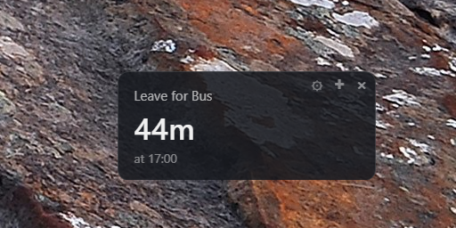

# CalendarTimer

A tiny, always-on-top, moveable desktop countdown to your next meeting.
Shows days/hours/minutes remaining; once under 5 minutes it switches to
minutes:seconds precision. Flashes your screen at 5 minutes, 1 minute, and
meeting start.



## Running (development)

```
npm install
npm start
```

First run has nothing to set up — it seeds `meetings.json` for you (copied
from the committed `meetings.example.json` template) and **automatically
opens the Edit Meetings window** so you can replace the example meetings
with your real ones right away. `meetings.json` is gitignored, so your
personal schedule is never committed if you push this repo.

A small floating card appears in the corner of your screen. Drag it
anywhere — its position is remembered between launches. Before you've
added anything, the card shows **"Click + to add your first meeting"**.
Click the **×** in the corner to quit, the **+** icon to open the meetings
editor, or the **⚙** gear icon to open Settings.

## Installing (recommended for everyday use)

Build a real Windows installer with:

```
npm run dist
```

This produces `dist\CalendarTimer Setup <version>.exe`. Run it — it
installs silently (no wizard clicks needed) and launches the app
automatically when done. It also:

- Creates a **Start Menu** shortcut named "CalendarTimer".
- Registers the app to **auto-start at Windows login**.
- Creates your personal, editable `meetings.json` under
  `%APPDATA%\CalendarTimer\meetings.json` (seeded from the one in this repo)
  and **automatically opens the Edit Meetings window** on that first launch.

**Pin to taskbar:** Windows doesn't allow apps to pin themselves to the
taskbar automatically. After first launch, right-click the CalendarTimer
icon in the taskbar (or its Start Menu shortcut) and choose
**"Pin to taskbar"** — a one-time manual step.

**Auto-start behavior:** If you click the **×** to quit, CalendarTimer
remembers that and will **not** reopen itself on your next login — it
stays closed until you launch it again yourself (Start Menu/taskbar).
Launching it manually re-arms auto-start for future logins. To disable
auto-start entirely, go to Windows Settings → Apps → Startup and turn
off CalendarTimer.

## Editing your meetings

The easiest way: click the **+** icon on the countdown card to open
the **Edit Meetings** window. It lists every meeting, lets you add/delete
rows, change the day/time/title, set recurrence (weekly, every-other-week,
or a one-time "Never" event with a specific date), and click **Save** —
changes apply immediately, no restart needed. This always edits whichever
`meetings.json` the running app actually uses, so there's no risk of
editing the wrong copy.

You can still hand-edit the JSON file directly if you prefer: once
installed, that's `%APPDATA%\CalendarTimer\meetings.json` (if running from
source/dev, it's `meetings.json` in this folder instead). The app
hot-reloads it automatically (no restart needed) a moment after you save.

Keyed by lowercase weekday (`sunday`…`saturday`), each a list of meetings
for that day:

```json
{
  "tuesday": [
    { "time": "11:05", "title": "PQO Standup" }
  ],
  "monday": [
    { "time": "16:00", "title": "Mentor meeting", "recurrence": "biweekly", "date": "2026-10-12" }
  ],
  "wednesday": [
    { "time": "15:00", "title": "Budget review (one-time)", "recurrence": "once", "date": "2026-11-04" }
  ]
}
```

- `time` — 24-hour `HH:MM`, local time.
- `title` — shown on the countdown card and the flash alert.
- `recurrence` — omit (or `"weekly"`) for every week. Use `"biweekly"` for
  every-other-week meetings, or `"once"` for a one-time event that never
  repeats ("Never" in the editor's Repeats dropdown).
- `date` — required for `biweekly` entries (any date, `YYYY-MM-DD`, on
  which the meeting actually occurs — used to calculate which weeks are
  "on") and required for `once` entries (the specific date it happens).
  A one-time entry is stored under the weekday its date falls on.

Multiple meetings per day are supported — just add more entries to that
day's array.

One-time (`"once"`) meetings are cleaned up automatically: once a one-time
event is more than 60 days in the past, the app removes it from
`meetings.json` on the next startup so the file doesn't accumulate stale
entries.

### Changing where `meetings.json` lives

Open **Settings** (gear icon) → **Meetings file** to see the path the app
is currently using. Click **Change location…** to pick a different file or
folder (e.g. a synced OneDrive/Dropbox folder) — if the new location is
empty, your current meetings are copied there; if it already has a
`meetings.json`-style file, that file's contents are loaded instead.
Click **Reset to default** to go back to the normal app-data location.


### Scheduling a meeting on several days at once

In the Edit Meetings window, the **Day** dropdown also offers **Everyday**,
**Weekdays (Mon–Fri)**, and **Weekend (Sat–Sun)** in addition to the 7
individual days. Picking one of these and saving expands the meeting into
the matching per-day entries under the hood (so `meetings.json` stays
simple, weekday-keyed arrays) — next time you open the editor, those linked
entries automatically collapse back into a single row. Editing the time or
title on that row and saving updates all of its days together.

## Alerts

Click the **⚙** gear icon on the countdown card to open **Settings**, where
you can configure:
- **Countdown appearance** — background color, opacity, and card size
  (small/medium/large)
- **Flash color** and **opacity**
- **Flash count** — 1 or 2 pulses (hard-capped at 2 per second)
- **Sound** — optional short beep on flash
- **When flashes occur** — any combination of 5 minutes before, 1 minute
  before, and/or the meeting's start time
- **Seconds display** — show seconds only under 5 minutes left (default),
  always, or never

Each alert fires once per meeting. Use **Test flash** in Settings to preview
your current flash configuration without waiting for a real meeting.

## Skipping or snoozing a meeting

Right-click the countdown card to skip the meeting it's currently showing
(jumps ahead to the next upcoming occurrence) or snooze it 5 minutes
(pushes the countdown/flash timing back without changing the meeting's
regular schedule). Both actions only affect that one occurrence — the
recurring meeting itself is untouched, and the override is forgotten if
left unused for more than a couple of days.

## Notes

- Window position is stored in your Electron userData folder
  (`%APPDATA%\CalendarTimer\window-state.json`), not in this project folder.
- `npm audit` may show vulnerabilities in `electron-builder`'s own
  build-time dependencies — these are dev-only tools used to produce the
  installer and are never shipped inside the packaged app.
